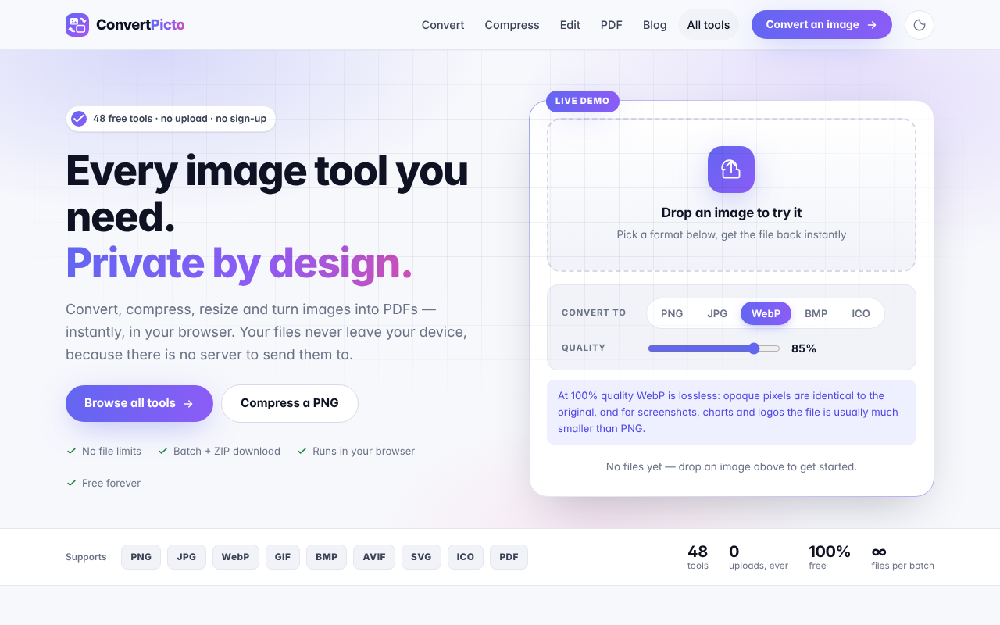

# ConvertPicto

**48 image tools that run entirely in your browser. No server, no upload, no frameworks.**

Live site: **[convertpicto.com](https://convertpicto.com)**

Every conversion, compression and edit happens on the visitor's own device using the Canvas API. There is no upload endpoint, because there is no server to receive one. Load a page, disconnect from the internet, and the tools keep working.

This repository is the whole project: a static-site generator that turns one config file into about 70 pages, and one JavaScript engine that powers every tool.



---

## Why this exists

Most online image converters upload your file to a server, process it there and send it back. That is fine for a meme and less fine for a scan of your passport. It also means queues, file size limits and a privacy policy you have to trust.

Browsers have been able to decode and re-encode images for years. For the common cases, the server is unnecessary.

## What's in it

- **28 format conversions** across PNG, JPG, WebP, AVIF, GIF, BMP, SVG and ICO.
- **Compression** for JPG, PNG and WebP, including real palette-based PNG optimisation, not just a re-save.
- **Compress to a target size** (20, 50, 100, 200 and 500 KB): it lowers JPEG quality first and shrinks pixels only when it has to.
- **Editing:** resize, rotate, flip, grayscale, and an edge-preserving **noise reduction** filter (bilateral filter, three strengths).
- **PDF:** single images, or many images combined into one PDF with a page list you can reorder.
- **Developer tools:** a multi-size favicon generator and an image-to-Base64 data URI converter.

All of it batch-capable, with ZIP download, drag-and-drop, clipboard paste, and settings that re-process already-loaded files live.

The `content/blog/` folder holds the site's guides. Several of them are measurements made by running the real pages in headless Chromium, for example [WebP vs PNG](https://convertpicto.com/blog/webp-vs-png) and [JPG vs WebP quality settings](https://convertpicto.com/blog/jpg-vs-webp-quality-settings).

---

## Architecture

```
build.py            Static site generator (Python standard library, Pillow optional)
src/engine.js       The entire client-side tool engine
src/styles.css      Design system, dark mode included
src/blog.py         Small Markdown renderer
src/covers.py       Generates the blog cover images (Pillow)
src/vendor/webp/    libwebp compiled to WebAssembly (see "Third-party code")
tests/              Playwright suite that verifies real output bytes
content/blog/       Articles in Markdown
```

### One engine, many tools

There is no per-tool JavaScript. Every tool page declares what it wants in a data attribute, and the shared engine reads it:

```html
<div id="tool" data-config='{"mode":"convert","from":"png","to":"jpg"}'></div>
```

`mode` is one of `convert`, `compress`, `resize`, `rotate`, `flip`, `grayscale`, `denoise`, `pdf` or `base64`. Adding a conversion is a line of config, not a new file.

### One generator, many pages

`build.py` holds the site config at the top, and every page is generated from it. Each tool definition produces a full page with an H1, benefit cards, a how-to, FAQs with `FAQPage` schema, related-tool links, breadcrumbs, canonical URL, Open Graph tags and a sitemap entry.

CSS and JavaScript are **inlined into every page**. There are no external stylesheets and no bundler. A page is one file that works when opened directly from disk.

---

## The interesting part: hand-written encoders

`canvas.toBlob()` gives you PNG, JPEG and WebP. Most of what else is here is written by hand in `src/engine.js`.

### Indexed PNG encoder

This is what makes the PNG compressor actually compress. A standard PNG stores 24-bit colour, which is 16 million possible values per pixel, when a logo might use twelve. The encoder:

1. Builds an optimised palette with **median-cut quantization**
2. Applies **Floyd-Steinberg dithering** to hide banding in gradients
3. Writes `IHDR`, `PLTE`, `tRNS`, `IDAT` and `IEND` chunks by hand
4. Computes **CRC32** for each chunk
5. Deflates the pixel data using the browser's native `CompressionStream`

Typical result on graphics and screenshots: 50 to 80% smaller, visually identical.

### Target-size compression

To get a photo under a size limit, the engine tries JPEG quality from 95% down to 50%. Only if even that is too big does it shrink the pixel dimensions, in the smallest steps it can, and then it binary-searches the quality again. A JPG that is already under the limit is returned unchanged.

### PDF writer

Images are embedded as `DCTDecode` streams, so the JPEG bytes go into the PDF without a second encode, with a correctly built xref table and byte offsets. Page sizing supports A4, US Letter and fit-to-image, with configurable margins.

### ICO, BMP and ZIP

Multi-size ICO uses the PNG-in-ICO container format, so a single file carries 16x16 through 256x256. BMP is a 24-bit writer with the row padding and bottom-up scanline order the format requires. ZIP uses the store method with correct local headers and a central directory.

### Noise reduction

A bilateral filter: each pixel becomes a weighted average of its neighbours, where a neighbour counts for less the further away it is and the more its colour differs. Flat areas are smoothed and edges are kept. It runs in chunks so the page stays responsive on large photos. On photos with added synthetic noise it raised PSNR and SSIM against the clean original; the numbers are in [How to fix grainy photos](https://convertpicto.com/blog/how-to-fix-grainy-photos). It is a classic filter, not a neural denoiser, and the page says so.

### The `toBlob` trap

Worth knowing if you build anything similar. `canvas.toBlob()` does **not** reject unsupported MIME types. It silently falls back to PNG and hands you a blob that looks successful:

```javascript
function encodeNative(canvas, mime, quality) {
  return new Promise((resolve, reject) => {
    canvas.toBlob((blob) => {
      // A PNG labelled as AVIF is still a PNG. Verify.
      if (blob && blob.type === mime) resolve(blob);
      else reject(new Error("Your browser can't export this format"));
    }, mime, quality);
  });
}
```

### SVG sizing

Browsers render an SVG with no explicit `width` and `height` at 300x150, regardless of its `viewBox`. The engine parses the viewBox, strips any existing dimensions, and injects explicit ones at 1024px wide before rasterising.

---

## Third-party code

The tools are plain JavaScript with no npm packages, with one exception. **Lossless WebP** uses [libwebp](https://developers.google.com/speed/webp) compiled to WebAssembly (via the `@jsquash/webp` package), because Chrome's built-in WebP encoder produces lossless files that are often larger than PNG. The files are in `src/vendor/webp/`, unmodified, with their licence (Apache-2.0) and a `NOTICE.txt`. The worker loads them only when a lossless WebP is requested, and the engine falls back to the browser's own encoder if they cannot load.

The site's own code is MIT licensed. The articles in `content/blog/` are the site's content.

---

## Quick start

Requires Python 3.8+. No packages are needed to build.

```bash
git clone https://github.com/shaam130/ConvertPicto.git
cd ConvertPicto
python3 build.py
```

Output lands in `dist/`. To use the WebAssembly encoder, serve `dist/` over HTTP, for example `python3 -m http.server -d dist`. Opening files directly from disk works for everything else.

Pillow is optional; install it if you want the blog covers, the social preview image and the apple-touch icon generated:

```bash
pip install pillow
```

## Configuration

Everything is at the top of `build.py`:

```python
CLEAN_URLS = True
SITE = {
    "name": "ConvertPicto",
    "domain": "https://convertpicto.com",
    "contact_email": "you@example.com",
    ...
}
ADS = {"enabled": False, "placeholders": False, "client": "ca-pub-XXXXXXXXXXXXXXXX"}
ANALYTICS = {"ga4": ""}   # e.g. "G-XXXXXXXXXX"
```

Change the name and domain, run the build, and it is your site.

## Adding a conversion

In `build.py`, add a pair to `CONVERSIONS`:

```python
CONVERSIONS = [
    ("png", "jpg"),
    ("heic", "jpg"),   # new
]
```

The build generates the page, the SEO markup, the internal links and the sitemap entry. The engine needs no change as long as the browser can decode the input.

## Adding a blog post

Drop a Markdown file into `content/blog/`. The front matter takes `title`, `h1`, `description`, `excerpt`, `date`, an optional `updated`, `keyword` and `tools`. Two custom blocks are available: `:::tool slug|Label:::` renders an inline tool card, and `:::note ...:::` a callout.

## Deploying

`dist/` is plain static files, so any host will do. For Apache, the generated `.htaccess` handles clean URLs (`/png-to-jpg` rather than `/png-to-jpg.html`), 301 redirects from the `.html` versions, gzip, cache headers, security headers and the `.wasm` MIME type. Set `CLEAN_URLS = False` if your host does not support rewrites.

## Testing

```bash
pip install playwright pillow pypdf numpy
playwright install chromium
python3 tests/test_site.py
```

The suite drives the real pages in headless Chromium and then verifies the **actual output bytes**: Pillow checks dimensions, colour modes and palette usage; pypdf checks page counts, sizes and page order; Python's `zipfile` verifies archive integrity; Base64 output is round-tripped byte for byte. Rotation and flipping are compared against Pillow's own implementations. It also checks that the target-size tools land under their limit, that lossless WebP keeps opaque pixels identical, and that noise reduction lowers the error against the clean image.

It also checks every page's links resolve, JSON-LD parses, titles are unique, and heading levels do not skip.

---

## Limitations

- **No HEIC, RAW, PSD or TIFF decoding.** Browsers cannot decode them, and shipping a decoder for each would outweigh the project.
- **Large files depend on the device.** A 100-megapixel image on an old phone is slow, where a server would be instant.
- **AVIF encoding** is only available where the browser supports it. The engine detects this and says so rather than silently producing a PNG.
- **Animated GIFs** convert their first frame only.
- **Noise reduction** is a classic filter. It reduces grain and keeps edges, but AI denoisers recover more fine texture.

## Browser support

Current Chrome, Edge, Firefox and Safari. PNG compression needs `CompressionStream` (Chrome 80+, Firefox 113+, Safari 16.4+). Old browsers get a clear message instead of a broken file.

## Licence

MIT for the code. See `LICENSE`. libwebp and the `@jsquash/webp` wrapper are Apache-2.0, see `src/vendor/webp/`.
